# Práctica P2 (Tema 2) — Informe

**Nombre:** Jaime Montalvo  
**Fecha:** 10/11/2026  
**Entorno usado:** local, Python 3.12 en `.venv`; ROS2 jazzy.

## Declaración de autoría y uso de IA

Trabajo individual. Fuentes consultadas: documentación incluida en el repositorio y
enunciado de la práctica. 

Uso de asistentes de IA: 
  Las anotaciones, hipotesís capturas de pantalla y todas las ejecuciones de los 
  comandos han sido realizadas a mano, y documentadas en un google docs para uso propio
  durante la ejecución de la tarea .
  Sin embargo, dichas anotaciones y capturas de pantalla han sido posteriormente proporcionadas
  a VSCODE para construir y organizar este archivo, por supuesto dicho archivo ha sido revisado.

### Preparación y pruebas iniciales

La preparación partió de los bags de referencia y de la plantilla del informe:

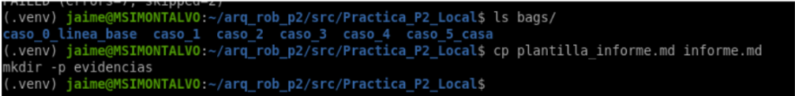

Las pruebas originales de `analiza_bag.py` se ejecutaron correctamente:

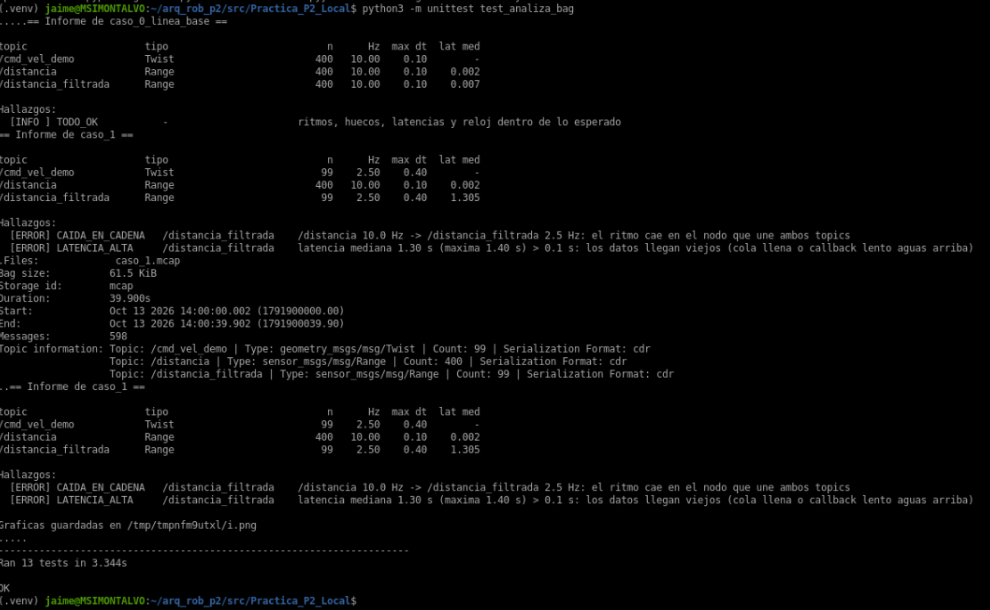

## Ejercicio 1 — Caso 5 (`bags/caso_5_casa`)

| Campo | Contenido |
|---|---|
| Síntoma | Frecuencia insuficiente en `/distancia`. |
| Hipótesis | El sensor publica a 1 Hz en lugar de los 10 Hz requeridos; esto puede provocar información desactualizada y una respuesta más lenta ante obstáculos. |
| Comando(s) | `python3 analiza_bag.py bags/caso_5_casa --info` y `python3 analiza_bag.py bags/caso_5_casa --esperado /distancia=10 --png informe_caso5.png` |
| Evidencia | Los tres topics tienen 40 mensajes en unos 39 s: `/distancia` 1.00 Hz, `/distancia_filtrada` 1.00 Hz y `/cmd_vel_demo` 1.00 Hz. El análisis informa `RITMO_BAJO: 1 Hz medidos frente a 10 Hz esperados`. |
| Eslabón | Publicación del sensor o configuración temporal del productor. |
| Familia | Temporización / frecuencia de publicación. |
| Causa raíz probable | Periodo de publicación configurado en 1 segundo en lugar de 0,1 segundos. |
| Arreglo y comprobación | Revisar el temporizador o parámetro de frecuencia del nodo productor y establecer 10 Hz. Repetir el análisis y comprobar que `/distancia` alcanza 10 Hz. |

Evidencia de la inspección estructural del bag:

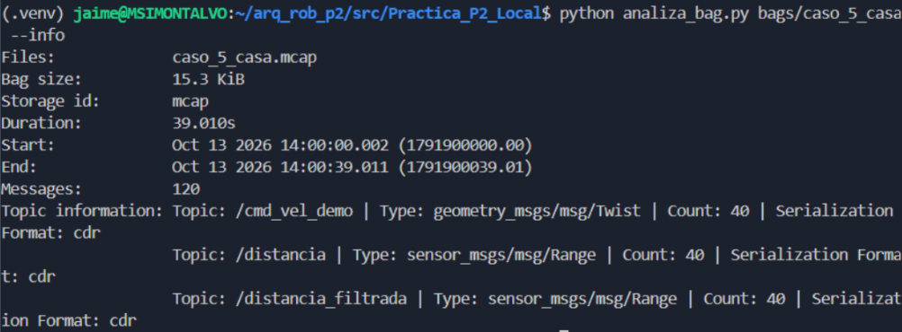

Evidencia del análisis temporal:

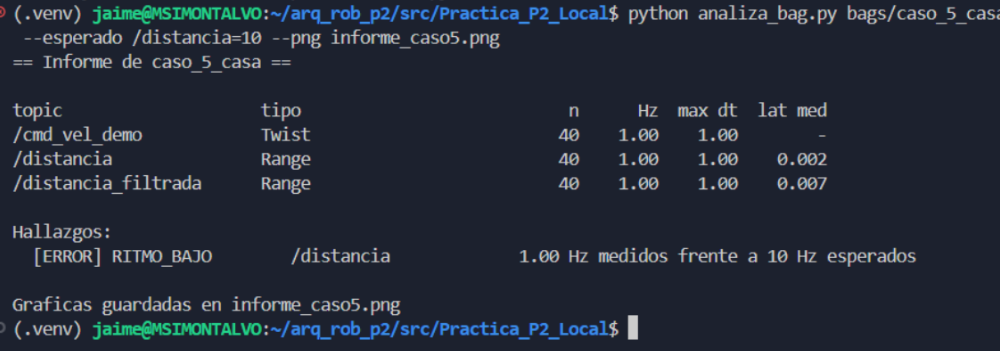


El grafo permite identificar la estructura de comunicación entre nodos, publicaciones y
suscripciones, pero que los nodos estén conectados no garantiza que se cumpla la
frecuencia requerida. El bag demuestra el comportamiento real: `/distancia` y
`/distancia_filtrada` funcionan a 1 Hz, con un intervalo máximo de 1 segundo. Como la
entrada y la salida tienen la misma frecuencia, el filtro reproduce el ritmo de entrada
y no se observa una reducción adicional atribuible al procesamiento. El problema está
probablemente en la generación o publicación de las medidas.

La gráfica muestra que el topic `/distancia` publica aproximadamente a 1 Hz, al
igual que `/cmd_vel_demo` y `/distancia_filtrada`. En cuanto a la latencia, las
medidas originales presentan unos 2 ms, frente a los 7 ms de las medidas filtradas,
por lo que el procesamiento introduce aproximadamente 5 ms adicionales.
El gráfico de valores muestra que el filtro suaviza correctamente las variaciones de
la señal original, manteniendo una evolución similar, aunque introduce un ligero
desfase temporal y cierta atenuación de la amplitud.

La comprobación de timestamps individuales confirma que los mensajes consecutivos de
`/distancia` están separados por aproximadamente 1 segundo (`dt` cercano a
`0.99999–1.00002 s`). Por tanto, no se observan pérdidas ni irregularidades
significativas dentro del bag: el problema es que el sensor publica de forma estable,
pero a 1 Hz en lugar de los 10 Hz requeridos. En conclusión, el nodo de filtrado
funciona correctamente respecto a la entrada y mantiene su ritmo; la causa probable
está en la configuración de frecuencia del productor del sensor.

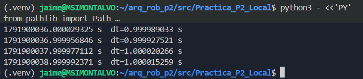

Esto coincide con el caso D de la S7, la fuente lenta: entrada y salida presentan la
misma frecuencia insuficiente. El grafo demuestra que existe comunicación, mientras
que el bag demuestra que no satisface el requisito temporal de 10 Hz.

Sin `--esperado`, la herramienta supone que el primer topic debe publicar a 10 Hz. Un
sensor diseñado correctamente para 1 Hz sería diagnosticado erróneamente como lento.
El requisito debe vivir en el contrato o especificación de la interfaz del sensor,
definiendo la frecuencia esperada de cada topic; el analizador debe recibirlo
explícitamente en lugar de asumir una frecuencia universal.

## Ejercicio 2 — Mis propios bags

Bags entregados: `mi_sano`, `mi_hueco`, `mi_hueco_float`, `mi_rango` y `mi_fallo`.

Comandos representativos:

```bash
python3 -c "import simulador_bags as s; s.generar('mi_sano', 'bags')"
python3 -c "import simulador_bags as s; s.generar('mi_hueco', 'bags', hueco=(10,14))"
python3 -c "import simulador_bags as s; s.generar('mi_hueco_float', 'bags', hueco=(10,14), tipo_mensaje='Float32')"
python3 -c "import simulador_bags as s; s.generar('mi_rango', 'bags', fuera_de_rango=(10,12,9.9))"
python3 -c "import simulador_bags as s; s.generar('mi_fallo', 'bags', post=s.mi_fallo)"
```

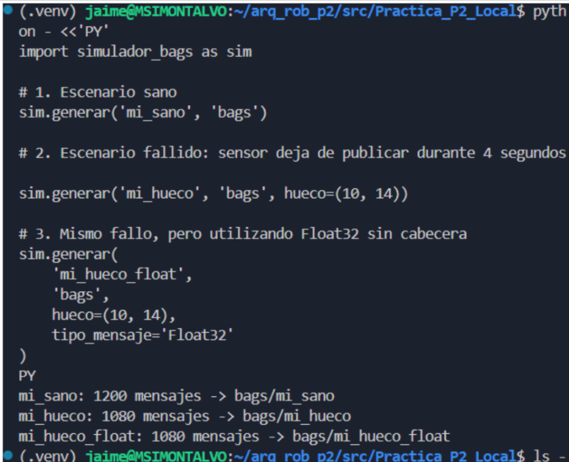

| Bag | `/distancia` | `/distancia_filtrada` | Hallazgos principales |
|---|---:|---:|---|
| `mi_sano` | 10 Hz, 400 mensajes | 10 Hz, latencia mediana 0.007 s | `TODO_OK` |
| `mi_hueco` | 9 Hz, hueco 10.0–14.1 s | 9 Hz, mismo hueco | `HUECOS`, origen en `/distancia` |
| `mi_hueco_float` | 9 Hz, hueco 10.0–14.1 s | 9 Hz, mismo hueco | Detecta hueco, no latencia ni sellos |
| `mi_rango` | 10 Hz | 10 Hz | La herramienta original da `TODO_OK`; la extensión detecta `RANGO_FUERA` |
| `mi_fallo` | 20.02 Hz por duplicación | 10 Hz | `CAIDA_EN_CADENA` por ritmo anómalo de entrada |

`mi_sano` valida el funcionamiento normal: 10 Hz en los tres topics, intervalos de
100 ms y ninguna anomalía. En los dos bags fallidos aparece un hueco de unos 4,1 s
entre los segundos 10 y 14,1. En `mi_hueco`, el hueco comienza en `/distancia` y se
propaga hacia abajp.

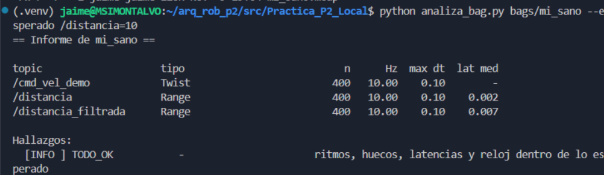

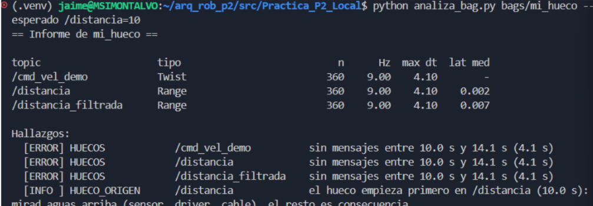

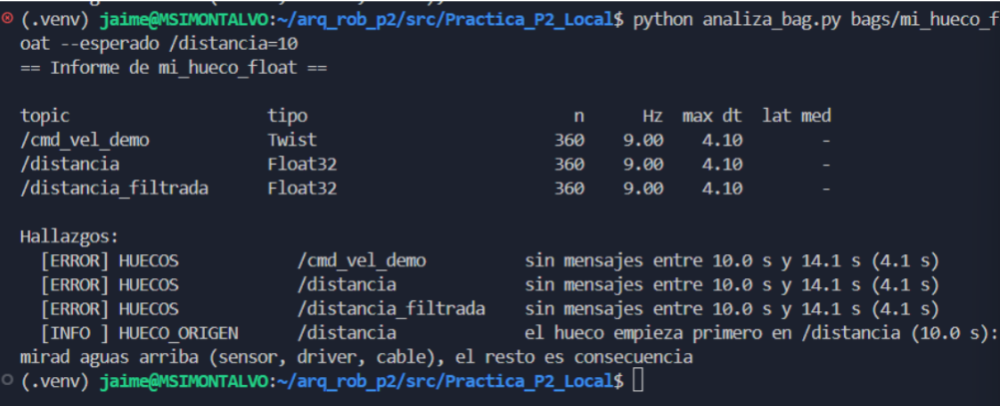

Con `Float32` no se puede calcular la latencia entre adquisición y recepción usando
`header.stamp`, ni comprobar la coherencia entre ambos relojes ni validar `frame_id`,
porque `std_msgs/Float32` solo contiene `data`. Sí se pueden calcular frecuencias y
huecos usando los timestamps de grabación del bag; por eso `HUECOS` y `HUECO_ORIGEN` no
desaparecen en este ejemplo. Lo que se pierde es la comprobación de latencia y de
coherencia temporal de la cabecera.

En un sistema real usaría un mensaje personalizado o un mensaje con `std_msgs/Header`,
añadiría el timestamp en el driver y correlacionaría el timestamp de adquisición con el
de recepción registrado por el suscriptor.

## Ejercicio 3 — Extensión de la herramienta

Se implementaron `comprobar_rangos` y la ampliación `comprobar_frames`. La primera
devuelve `ERROR/RANGO_FUERA` porque un valor físicamente imposible debe hacer fallar la
validación; admite un margen explícito, por defecto 0.0. La segunda devuelve
`WARN/FRAME_MIXTO` porque mezcla de frames es una inconsistencia que requiere revisión,
pero no prueba por sí sola que el sistema esté detenido.

El trabajo se realizó en la rama independiente `ej3-rango`, antes de integrarse en
`main`. La rama se publicó en GitHub y su Pull Request fue revisado y fusionado:

Pruebas propias añadidas:
`test_valores_exactamente_en_los_limites` comprueba que los límites son válidos, y
`test_varios_frames_con_muestras_vacias` comprueba lista vacía y varios frames.

`python3 -m unittest -v test_mis_comprobaciones` terminó correctamente: 11 pruebas,
todas superadas. Sobre `mi_rango`, el analizador original daba `TODO_OK`; la comprobación
adicional informa `ERROR RANGO_FUERA` con las muestras fuera de `[0.02, 4.0]`.
El problema inicial era que `analiza_bag.py` podía informar `TODO_OK` aunque
`mi_rango` contuviera valores de 9,9 m, superiores al `max_range` declarado de 4,0 m.
La nueva comprobación recorre las muestras y valida que cada valor esté dentro de los
límites físicos del mensaje. Se eligió `ERROR` para `RANGO_FUERA` porque una medida
imposible no debe aceptarse como válida. La ampliación de frames genera un `WARN`
porque mezclar `frame_id` requiere revisión, pero no implica necesariamente que el
sistema se haya detenido. El margen configurable permite admitir pequeños errores de
redondeo sin ocultar desviaciones importantes. Las pruebas cubren también el caso
normal, los límites exactos, valores por encima y por debajo, el margen, listas vacías,
bags reales y varios frames. Antes de implementar las funciones las pruebas fallaban
con `NotImplementedError`; después terminaron correctamente con 11 pruebas superadas.


Las capturas siguientes conservan la evidencia del estado inicial en rojo, cuando
`comprobar_rangos` todavía lanzaba `NotImplementedError`:

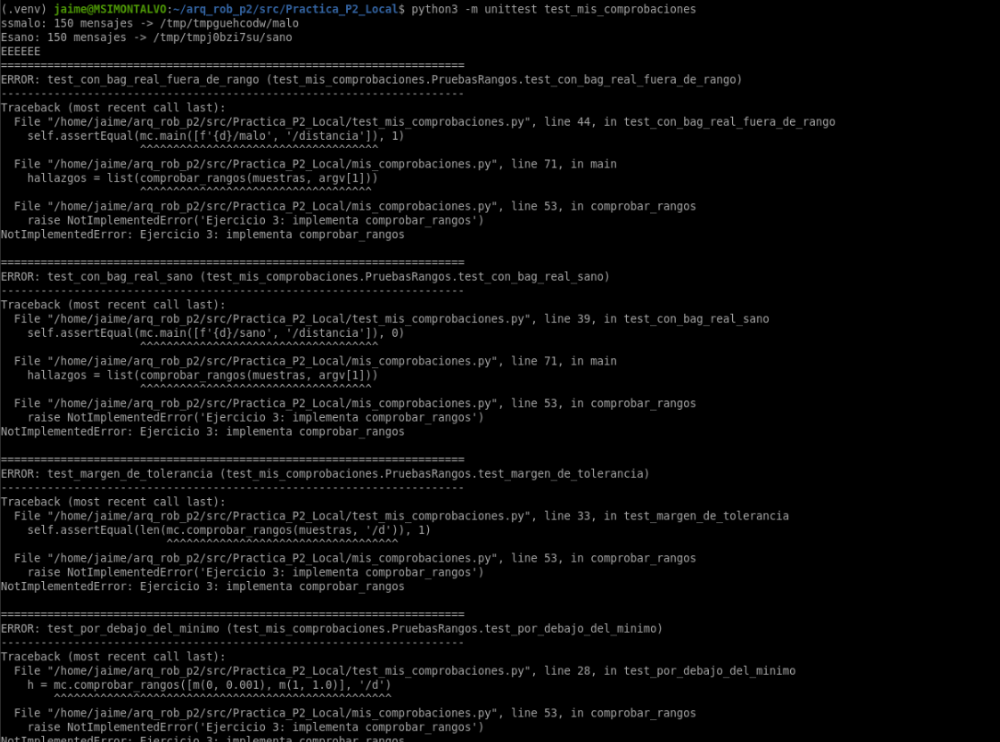

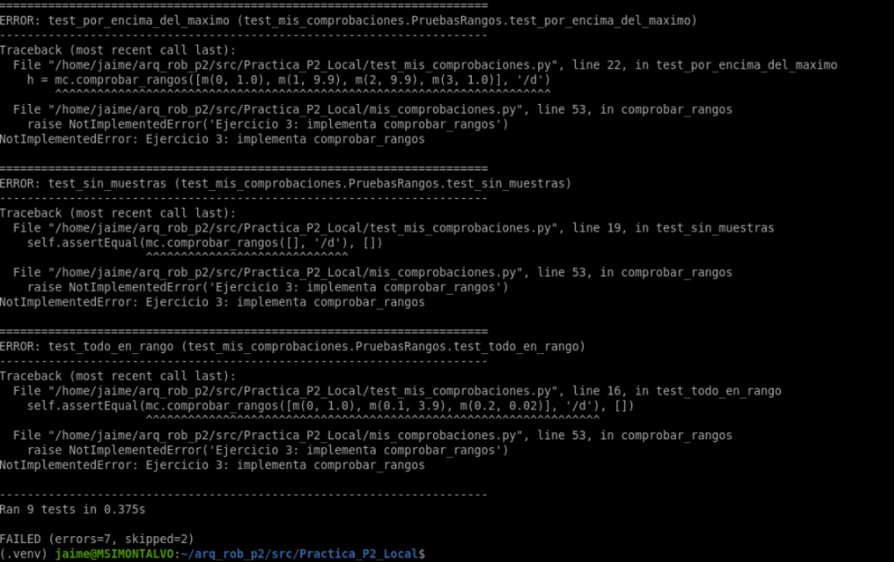

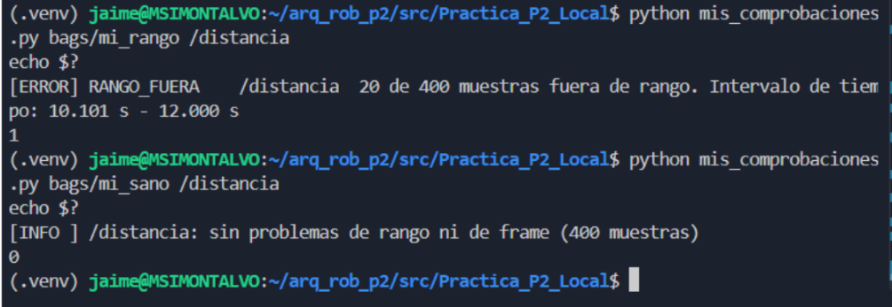

Las capturas siguientes conservan la evidencia del estado inicial en rojo, cuando
`comprobar_rangos` todavía lanzaba `NotImplementedError`:


## Ejercicio 4 — Un quinto fallo

Ficha entregada en `reto/reto_1_ficha.md` junto con `reto/reto_1/reto_1.mcap`.

- **Nombre del bag:** `mi_fallo` (empaquetado como `reto_1`).
- **Síntoma:** `/distancia` tiene aproximadamente el doble de frecuencia, mientras el
  topic posterior conserva la frecuencia nominal.
- **Qué debe averiguar quien lo resuelva:** identificar la anomalía, su punto de origen
  y por qué las estadísticas pueden interpretarse mal.

El fallo se genera con `simulador_bags.mi_fallo`: cada mensaje de `/distancia` se
duplica con 1 ms de separación. `analiza_bag.py` lo manifiesta como
`CAIDA_EN_CADENA` porque compara 20.02 Hz de entrada con 10 Hz de salida, aunque la
causa real es de duplicación. El arreglo es eliminar la publicación
duplicada y verificar que `/distancia` vuelve a 10 Hz sin `CAIDA_EN_CADENA`.

No hubo intercambio con compañero: sin intercambio.

Implementación de la función que duplica los mensajes:

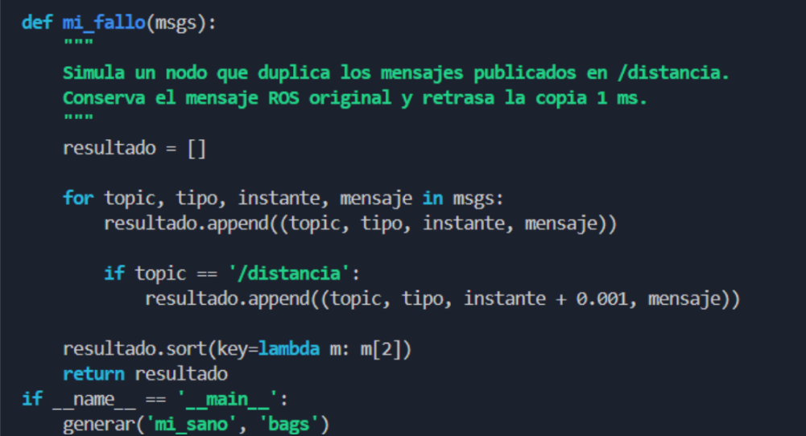

Generación e inspección del bag:

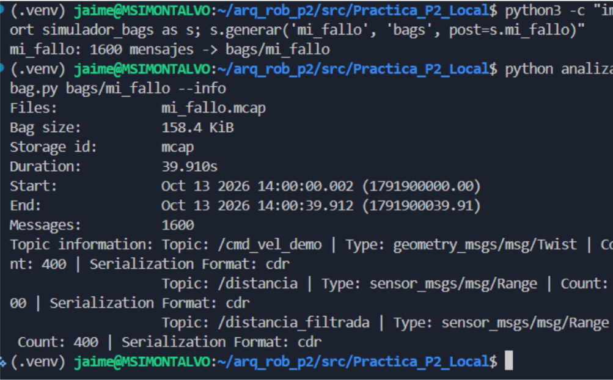

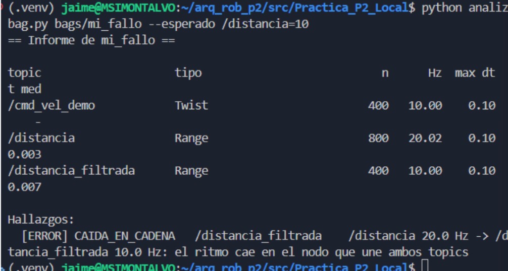

El análisis muestra 800 mensajes en `/distancia` frente a 400 en los demás topics y
una frecuencia de 20.02 Hz. Los timestamps de grabación y los sellos de mensaje
confirman la duplicación separada por aproximadamente 1 ms:

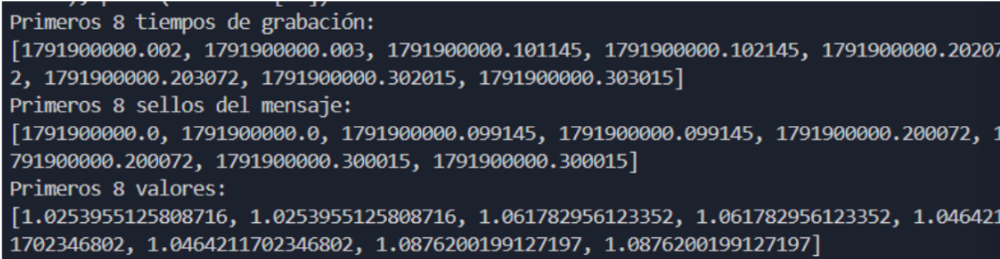

## Ejercicio 5 — Lista de comprobación ampliada

Además de las siete preguntas de la S7, se incorporan estas comprobaciones:

| # | Pregunta | Herramienta | Detecta | Caso que la justifica |
|---|---|---|---|---|
| 8 | ¿Los valores están dentro de los límites físicos del sensor? | `mis_comprobaciones.py` | Valores imposibles (`RANGO_FUERA`) | `mi_rango` publica 9,9 m aunque `max_range` es 4,0 m. |
| 10 | ¿El mensaje contiene una cabecera temporal? | `ros2 interface show`, `ros2 topic echo` | Si se puede medir latencia y validar `frame_id` | `Float32` solo contiene `data`, mientras `Range` incluye `header.stamp` y `frame_id`. |
| 11 | ¿Hay mensajes duplicados? | `ros2 bag info`, timestamps y `analiza_bag.py` | Frecuencia anormal o duplicación de publicaciones | `mi_fallo` contiene 800 mensajes en `/distancia` y alcanza 20,02 Hz. |

Se han añadido 2 extras (Estaba inspirado):

| # | Pregunta | Herramienta | Detecta | Caso que la justifica |
|---|---|---|---|---|
| 12 | ¿El tamaño de la cola es suficiente para el ritmo de entrada? | Parámetros ROS2 y `ros2 param get` | Descartes por cola llena cuando el callback es lento | Un callback de 400 ms con entrada a 10 Hz llena una cola de profundidad 10. |
| 13 | ¿Se están descartando mensajes por QoS incompatible? | `ros2 topic info /distancia --verbose` | Incompatibilidad entre `BEST_EFFORT` y `RELIABLE` | Un sensor publica con `BEST_EFFORT` y el filtro exige `RELIABLE`, por lo que no recibe datos. |

## Ejercicio 6 — Autoformación guiada

Durante la autoformación he trabajado las cuatro etapas de la guía:

En primer lugar, he aprendido a utilizar rosbag2 para grabar mensajes de diferentes topics y reproducirlos posteriormente. 
He comprobado cómo consultar la información de una grabación mediante ros2 bag info y cómo controlar su reproducción utilizando parámetros como la velocidad, el desplazamiento inicial y la duración.

También he experimentado con las opciones avanzadas de almacenamiento y compresión. 
He generado grabaciones divididas en varios archivos mediante el parámetro de duración máxima, comparado los formatos MCAP y SQLite3
y probado la compresión Zstandard tanto en modo archivo como en modo mensaje. Además, he configurado perfiles QoS mediante archivos YAML para controlar las características de las comunicaciones durante la grabación y la reproducción.

En la segunda parte he trabajado con RViz2 y tf2. He aprendido a visualizar las relaciones entre los sistemas de referencia de los elementos del robot, 
interpretar el árbol de transformaciones generado mediante view_frames y consultar las transformaciones entre dos frames con tf2_echo. 
En RViz2 he configurado el sistema de referencia global y añadido la visualización TF para observar los frames world, turtle1 y turtle2. He de destacar que esperaba más diferencias frente a ROS, la adaptación ha sido muy sencilla

Por último, he aplicado un procedimiento de depuración. Gracias a comandos como ros2 topic list -t, ros2 topic info -v, ros2 node list y ros2 node info he inspeccionado las comunicaciones entre nodos. He detectado que había dos simuladores publicando simultáneamente en /turtle1/pose, lo que provocaba una frecuencia agregada superior a la esperada. Al detener el simulador duplicado, la frecuencia se estabilizó (Referencia al ejercicio 4). También he reproducido un problema de incompatibilidad QoS entre un publicador BEST_EFFORT y un suscriptor RELIABLE, comprobando que no se recibían mensajes, y lo he solucionado configurando el suscriptor con una política compatible.
  

### Evidencias de la preparación del entorno

La primera captura demuestra que el comando principal de rosbag2 está disponible y
que incluye las operaciones `record`, `info`, `play`, `convert` y `reindex`.

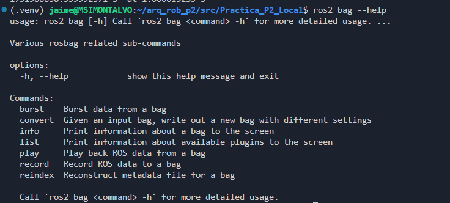

La variable `ROS_DISTRO` confirma que el entorno utilizado es **ROS 2 Jazzy**.

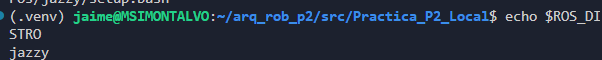

También comprobé que están instalados los paquetes necesarios para esta guía:
rosbag2, almacenamiento MCAP, RViz2, tf2 y turtlesim.

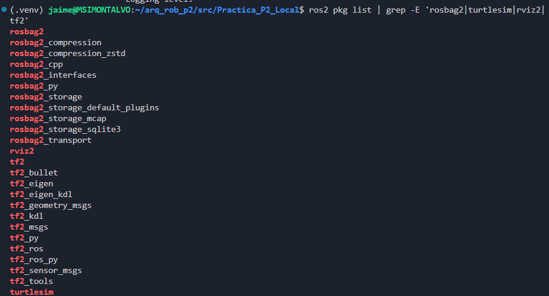

Finalmente preparé un directorio separado para guardar bags, configuraciones,
evidencias e informes, evitando mezclar los resultados de la guía con el código de
la práctica.

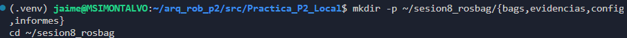

La siguiente captura confirma la ruta de trabajo `~/sesion8_rosbag`, la estructura
de subdirectorios y que la ayuda de `ros2 bag` se guardó también como evidencia
reproducible.

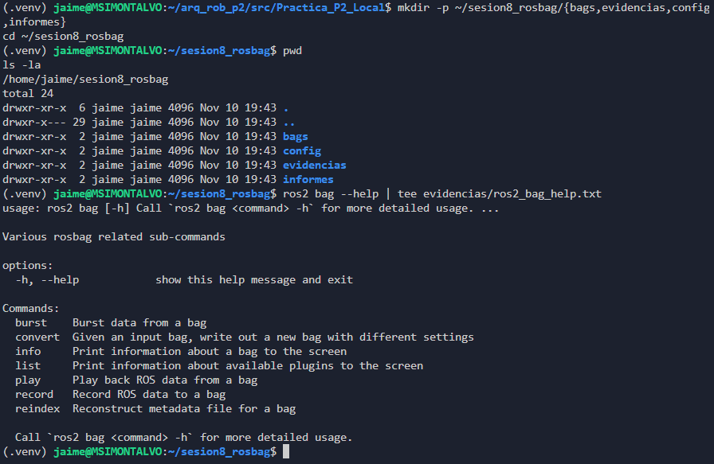

### Evidencias de rosbag2 básico con turtlesim

Ejecuté turtlesim y el teleoperador para generar movimiento y mensajes reales. La
captura muestra el control desde teclado y la ventana de turtlesim.

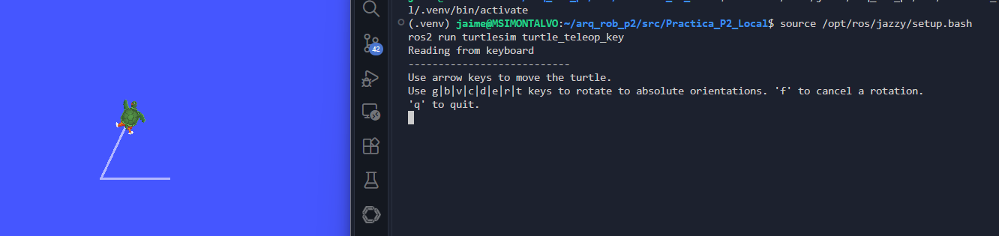

Antes de grabar comprobé los topics disponibles y sus tipos. Aparecen, entre otros,
`/turtle1/cmd_vel`, `/turtle1/color_sensor` y `/turtle1/pose`.

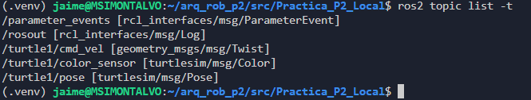

Con `ros2 topic info -v` verifiqué que `/turtle1/pose` tiene un publicador
`turtlesim` y un perfil QoS `RELIABLE` y `VOLATILE`. Después usé
`ros2 topic echo` para confirmar que se reciben valores de posición y orientación.

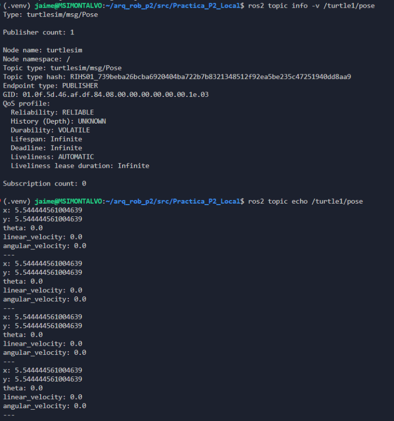

Grabé los topics seleccionados con `ros2 bag record`. La información del bag
confirma que se creó un fichero MCAP de unos 315 KiB, con una duración aproximada
de 38,9 segundos y 4.944 mensajes.

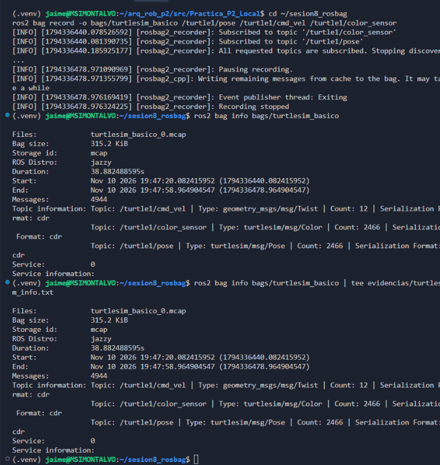

La misma información se conserva en una captura independiente de `ros2 bag info`,
donde se observan el formato MCAP, la distribución Jazzy, los tiempos de inicio y
fin y el número de mensajes por topic.

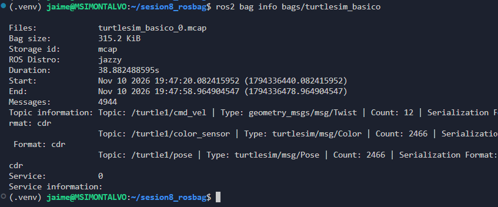

### Evidencias de rosbag2 avanzado

Consulté las opciones de `ros2 bag record` relacionadas con compresión. La salida
permite distinguir los algoritmos y niveles de compresión, el tamaño de la cola y
el número de hilos, aspectos que influyen en el tamaño final del bag y en el coste
de grabación.

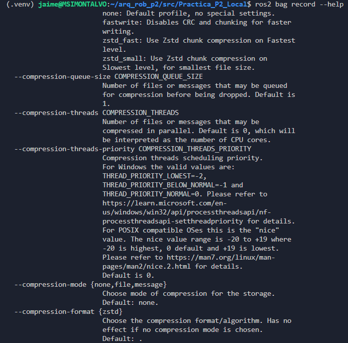

También revisé las opciones avanzadas de `ros2 bag play`, incluyendo pausa inicial,
desplazamiento temporal, límites de reproducción, espera de confirmación de los
suscriptores y nivel de logs.

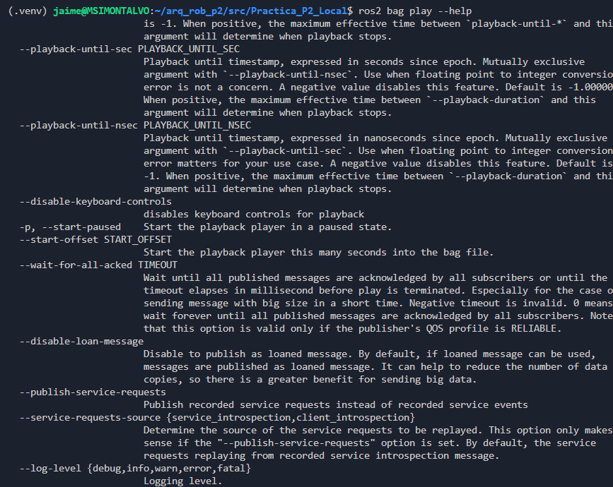

Probé la reproducción acelerada con `--rate 2.0` y limitada a diez segundos con
`--playback-duration 10`. La salida confirma que el reproductor usa velocidad 2 y
se detiene al alcanzar el límite indicado. Esto permite hacer pruebas más rápidas
sin cambiar los mensajes almacenados en el bag.

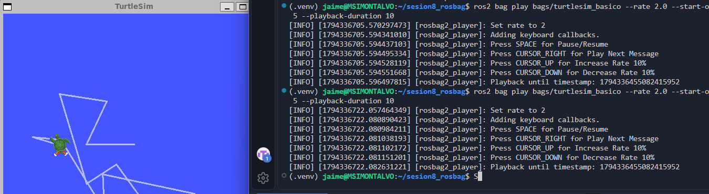

También comprobé la partición de un bag. El resultado crea ocho ficheros MCAP
(`turtlesim_split_0.mcap` a `turtlesim_split_7.mcap`) que forman un único bag
lógico de 72,07 segundos y 9.150 mensajes. Por tanto, particionar no elimina
mensajes: distribuye el almacenamiento en varios ficheros.

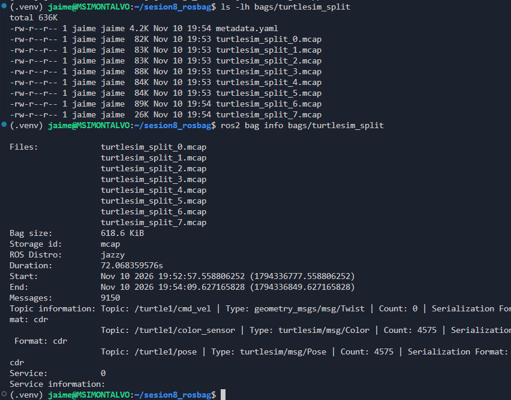

Para estudiar compresión grabé otro bag con Zstandard. El resultado ocupa 124,7 KiB,
contiene 7.630 mensajes y conserva los dos topics de turtlesim. La extensión
`.mcap.zstd` y la reducción del tamaño muestran que la compresión se aplicó.

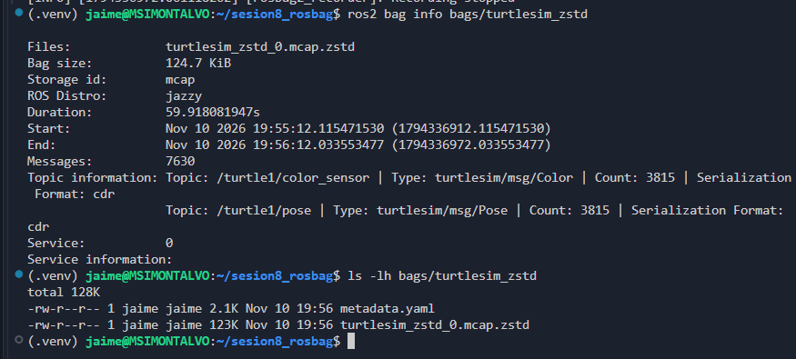

La siguiente prueba usa explícitamente `--compression-mode message` y
`--compression-format zstd`. En `ros2 bag info` aparecen 2.696 mensajes y un tamaño
de 196,8 KiB; el fichero `metadata.yaml` confirma `compression_format: zstd` y
`compression_mode: MESSAGE`.

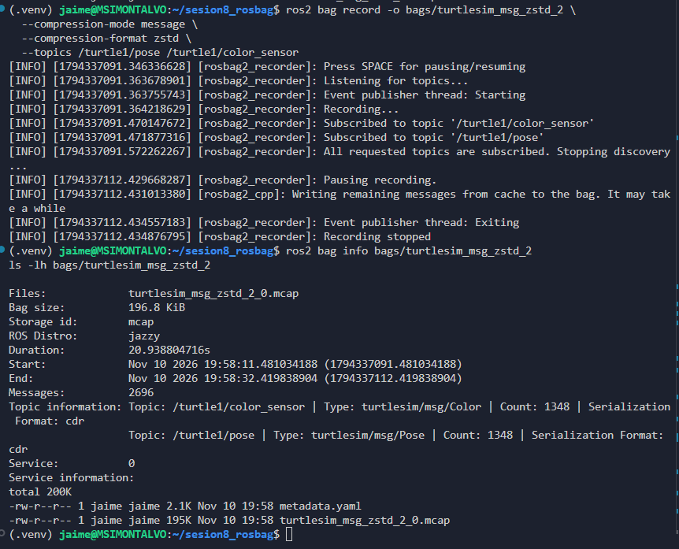

Además de MCAP, probé el almacenamiento `sqlite3`. El bag resultante ocupa 170,0 KiB,
usa el fichero `turtlesim_sqlite_0.db3` y contiene 2.692 mensajes. Esto permite
comparar el formato de almacenamiento sin modificar los topics ni sus tipos.

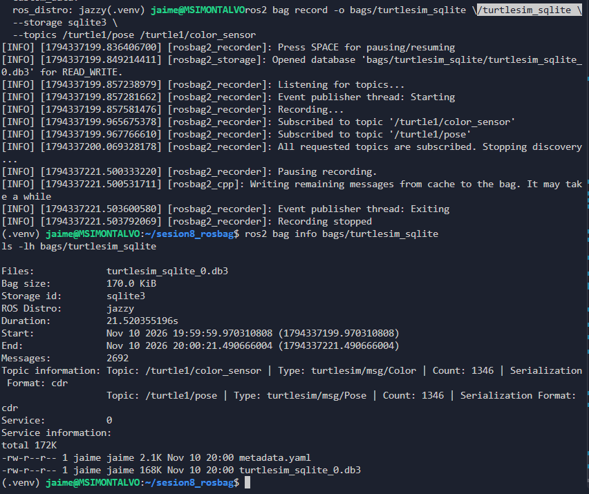

Como comparación controlada, grabé otro bag con MCAP sin compresión. En esa prueba
se obtuvieron 137,4 KiB, 2.116 mensajes y una duración de 16,91 segundos. Estos
tamaños no deben interpretarse como una comparación absoluta porque las duraciones
y cantidades de mensajes no son idénticas, pero sí sirven para comprobar que el
backend y la compresión aparecen reflejados en la información del bag.

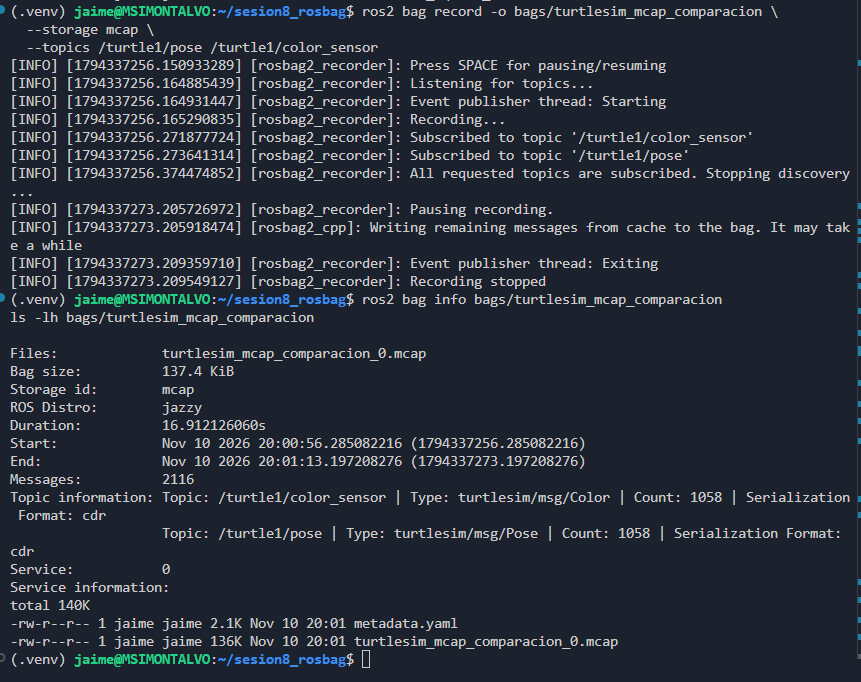

Por último preparé un fichero de overrides QoS con `keep_last`, profundidad 10,
fiabilidad `reliable` y durabilidad `volatile` para `/turtle1/pose` y
`/turtle1/color_sensor`. La salida confirma que rosbag2 aplica el perfil durante la
grabación y vuelve a aplicar el mismo override durante la reproducción.

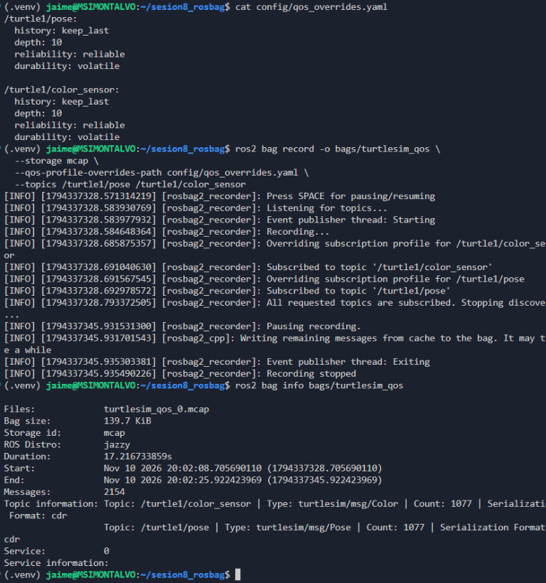

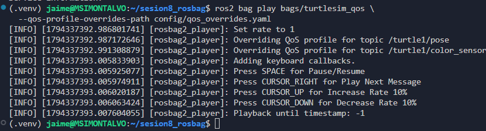

La inspección final del bag grabado con QoS confirma que se almacenaron 2.154
mensajes en MCAP, repartidos entre `/turtle1/pose` y
`/turtle1/color_sensor`, con 1.077 mensajes por topic.

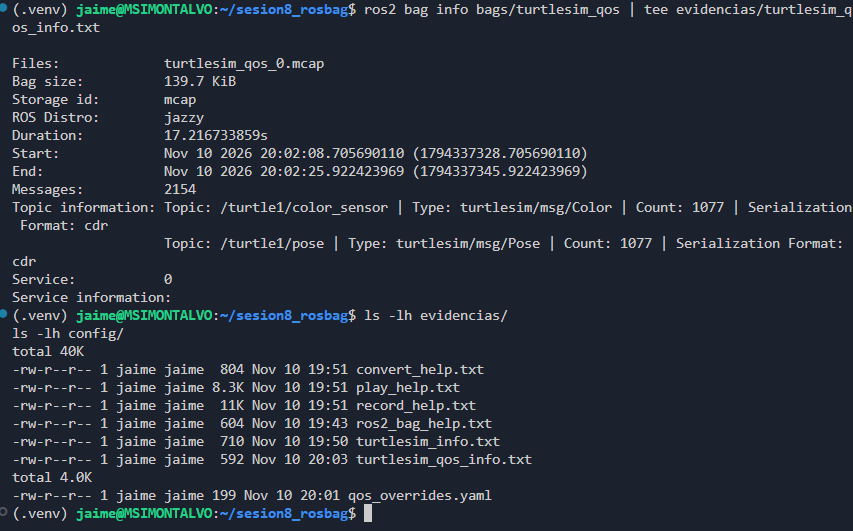

### Evidencias de RViz2 y tf2

Comprobé que el entorno dispone de RViz2 y de las herramientas tf2 necesarias.
Además, instalé el paquete `turtle_tf2_py`, que contiene el ejemplo utilizado
para practicar transformaciones entre las tortugas.

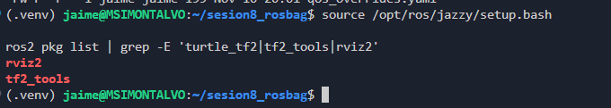

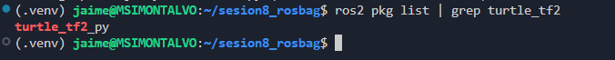

Después lancé `turtle_tf2_demo.launch.py`. La salida muestra los nodos
`turtle_tf2_broadcaster`, `turtle_tf2_listener` y `turtlesim`, y confirma que se
crearon `turtle1` y `turtle2`. La ventana de turtlesim permite observar el
movimiento de las dos tortugas.

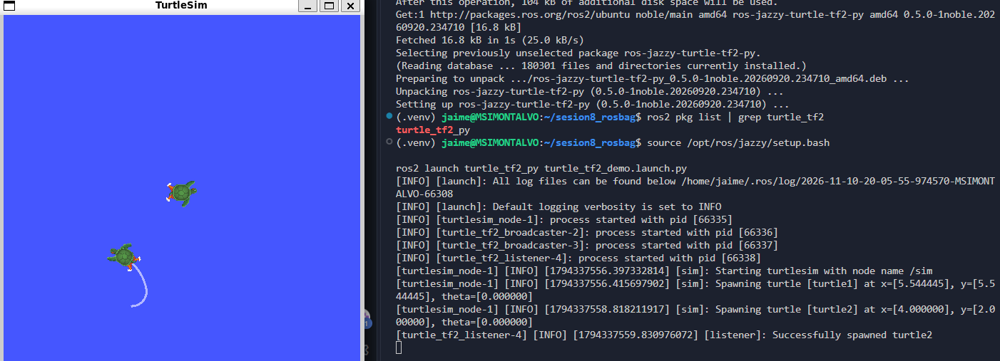

Con `tf2_echo` consulté la transformación entre `world` y `turtle1`. La salida
incluye la traslación, el cuaternión, la rotación RPY y la matriz de transformación.
Al principio aparece un aviso porque el frame aún no existía; después se reciben
transformaciones válidas en distintos instantes.

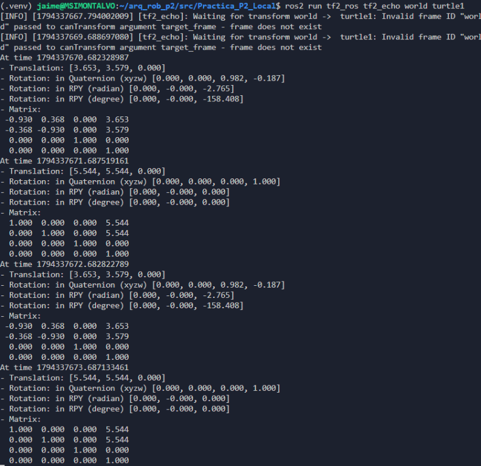

Como comprobación adicional, consulté directamente la transformación
`turtle1 → turtle2`. `tf2_echo` muestra valores que cambian con el tiempo para la
traslación y la orientación, por lo que no se trata de una transformación fija
inventada: depende de la posición actual de las dos tortugas.

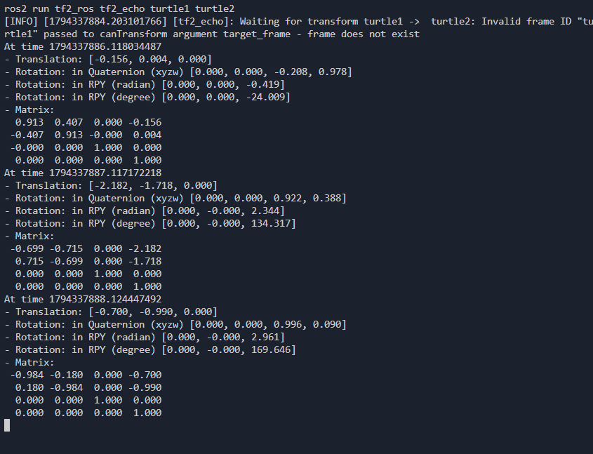

Finalmente abrí RViz2 junto con turtlesim. En la primera vista se observa el grid
3D y los ejes de referencia; en la segunda se distinguen los frames `turtle1` y
`turtle2` separados dentro del frame fijo `world`. Esto confirma visualmente que
las transformaciones publicadas por el demo pueden inspeccionarse desde RViz2.

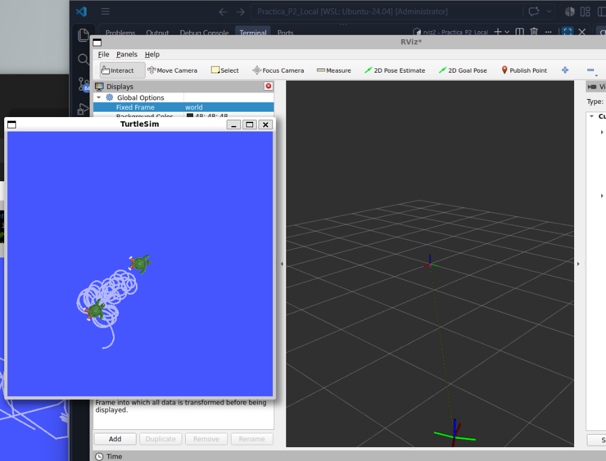

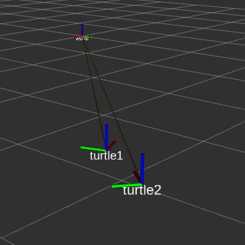

### Comprobación práctica de QoS

Con `ros2 topic info -v /turtle1/pose` comprobé que tanto el publicador `sim` como
el suscriptor `broadcaster1` usan `RELIABLE` y `VOLATILE`. Al coincidir la
fiabilidad, la comunicación es compatible y el broadcaster puede recibir los
mensajes de pose.

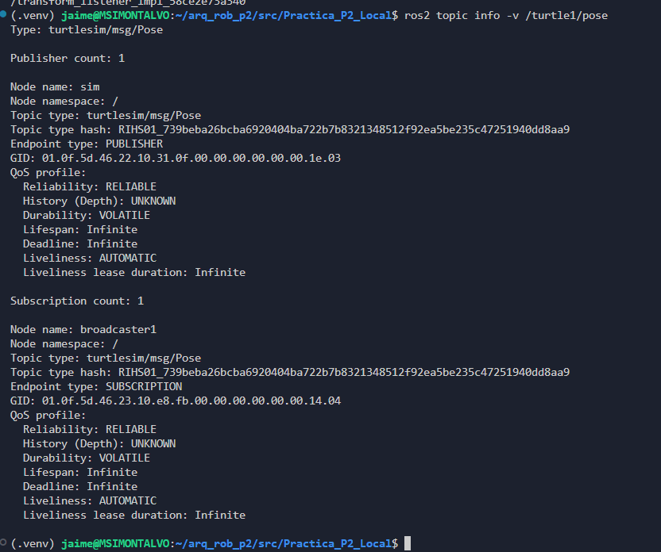

Después publiqué mensajes de prueba en `/diagnostico_qos` con fiabilidad
`BEST_EFFORT`. La captura confirma que el publicador está enviando seis mensajes
del tipo `std_msgs/msg/String`.

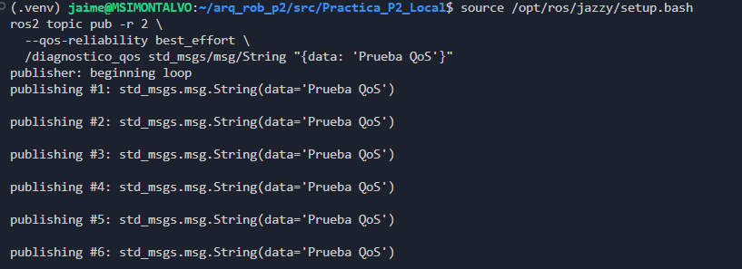

Con `ros2 topic echo` comprobé que los mensajes publicados se reciben cuando el
suscriptor también solicita `BEST_EFFORT`. Se observan repetidamente los datos
`Prueba QoS`, por lo que el problema no está en la publicación ni en el contenido
del mensaje, sino en la política QoS del suscriptor incompatible.

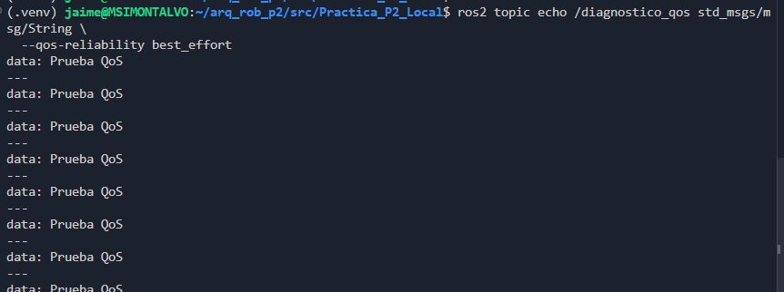

Al observar el topic con un suscriptor que exige `RELIABLE`, ROS 2 muestra el aviso
de política QoS incompatible y especifica que no se recibirán mensajes. Esta prueba
demuestra la diferencia entre que exista un topic y que realmente haya
comunicación compatible entre publicador y suscriptor.

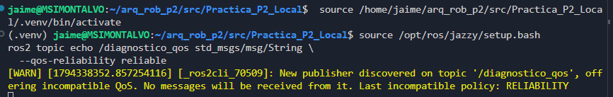

La inspección detallada del topic confirma ambos extremos: el publicador usa
`BEST_EFFORT` y el suscriptor `RELIABLE`. Por tanto, aunque el topic existe y tiene
un publicador y un suscriptor, sus perfiles no son compatibles para entregar los
mensajes.

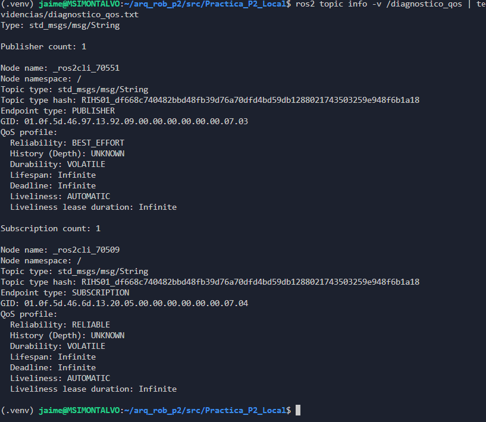

Como corrección de la prueba, lancé el publicador y el suscriptor usando ambos
`BEST_EFFORT`. En ese caso `ros2 topic info -v` muestra `BEST_EFFORT` en los dos
extremos y la comunicación vuelve a ser compatible.

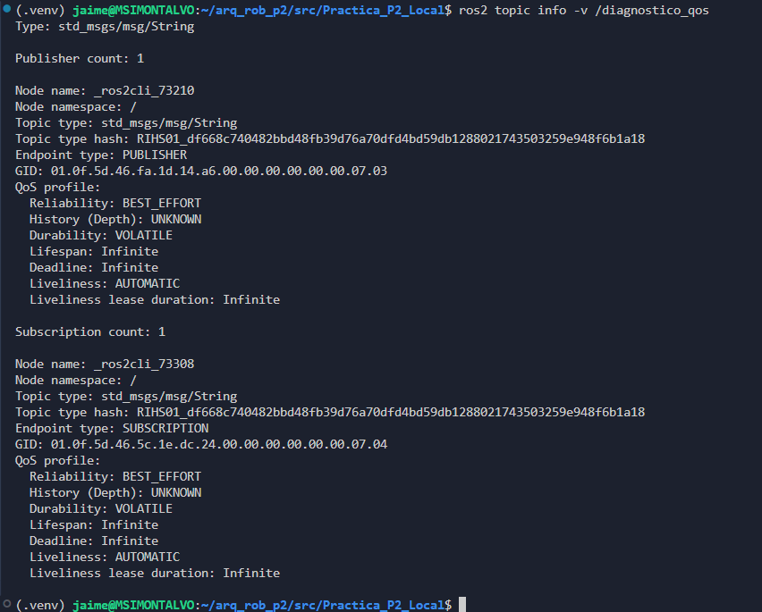

La recepción corregida también quedó registrada en una captura adicional, donde se
ven repetidos los mensajes `Prueba QoS`. Esto confirma el arreglo experimental:
el cambio del perfil del suscriptor permite recibir los datos sin cambiar el topic
ni el tipo de mensaje.


La orden de publicación utilizada queda documentada en la siguiente evidencia.
Usa `ros2 topic pub -r 2` y `--qos-reliability best_effort`, por lo que publica
dos mensajes por segundo con el perfil seleccionado.


Los resultados de texto de la prueba se conservaron en
[s8_diagnostico_qos_corregido.txt](evidencias/s8_diagnostico_qos_corregido.txt).

### Evidencia de reproducción

Reproduje el bag con `ros2 bag play`. La salida confirma que el reproductor se
inicia a velocidad 1 y queda reproduciendo hasta el final del bag. La ventana de
turtlesim muestra las posiciones recibidas durante la reproducción.


Como evidencia adicional del punto de control general, guardé la salida de ayuda
en un fichero de texto y la información del bag `mi_sano`:

[Evidencia: opciones de ros2 bag](evidencias/ros2_bag_help.txt)

[Evidencia: información del bag mi_sano](evidencias/ros2_bag_info_mi_sano.txt)

[Evidencia: interfaz sensor_msgs/Range](evidencias/ros2_interface_range.txt)

[Evidencia: transformación TF2 entre base_link y sensor_link](evidencias/tf2_echo_base_sensor.txt)

Como evidencias adicionales de la guía se conservaron las ayudas de `record`,
`play` y `convert`, junto con la información de turtlesim y su QoS:

- [Ayuda de ros2 bag record](evidencias/s8_record_help.txt)
- [Ayuda de ros2 bag play](evidencias/s8_play_help.txt)
- [Ayuda de ros2 bag convert](evidencias/s8_convert_help.txt)
- [Información de turtlesim](evidencias/s8_turtlesim_info.txt)
- [Información QoS de turtlesim](evidencias/s8_turtlesim_qos_info.txt)
- [Transformación turtle1 → turtle2 en texto](evidencias/s8_transformacion_turtle1_turtle2.txt)

También generé el informe de frames de tf2. El PDF permite conservar una
representación reproducible de la relación entre los marcos publicados durante
la ejecución del demo:

[Informe de frames tf2 en PDF](evidencias/s8_frames_2026-11-10_20.07.00.pdf)

Además, las capturas del apartado opcional documentan la reproducción real con
`ros2 bag play`, `ros2 topic echo` y `ros2 topic hz`. La principal duda que me queda
es cómo dimensionar la cola según el ritmo y el tiempo de callback, y cómo distinguir
en un sistema vivo una pérdida de mensajes de una incompatibilidad de QoS. También
quiero practicar una configuración completa de RViz2 con TF dinámico y `/clock`.

## Ejercicio 7 — Repositorio Git con integración continua

| Campo | Contenido |
|---|---|
| URL del repositorio | `https://github.com/JaimeMontalvo55/aq_rob_2` |
| Nº de commits y ramas | Historial local con más de 6 commits; ramas `main`, `ej3-rango` y `respaldo-completo`. |
| Pull Request | Merge de `ej3-rango` en `main`, registrado en el historial como [PR #1](https://github.com/JaimeMontalvo55/aq_rob_2/pull/1). La prueba de CI roja se corrigió y fusionó en el [PR #2](https://github.com/JaimeMontalvo55/aq_rob_2/pull/2). |
| CI verde | [Ejecución verde en GitHub Actions](https://github.com/JaimeMontalvo55/aq_rob_2/actions/runs/42830337524), además de la validación local reproducible en `evidencias/ci_verde.txt`. |
| CI rojo y arreglo | Se introdujo deliberadamente `ERROR_INVENTADO` en `esperado.json` para que `caso_0_linea_base` dejara de coincidir con el contrato. La regresión pasó de 6/6 a 5/6 y la CI quedó en rojo. La [ejecución roja](https://github.com/JaimeMontalvo55/aq_rob_2/actions/runs/42828950019) permitió localizar el fallo; después se eliminó el error inventado con un commit nuevo y se volvió a ejecutar la CI hasta dejarla verde. |
| Diagnóstico | El log de regresión identificó `caso_0_linea_base` como el único fallo: se esperaba `ERROR_INVENTADO`, pero el analizador obtuvo ningún error. La causa estaba en el contrato de regresión modificado, no en la herramienta. |
| Bags añadidos al contrato | `mi_rango`, para fijar el comportamiento actual del analizador base (`salida 0`, sin errores). |

La siguiente evidencia muestra la regresión en rojo después de introducir el fallo
deliberado:


El cambio realizado en `esperado.json` añade `ERROR_INVENTADO` al bag sano:


La rama de prueba se publicó como `prueba-ci-roja`:


La ejecución de GitHub Actions aparece en rojo en el paso de pruebas/regresión:


Para completar la recuperación exigida por el ejercicio, se debe eliminar
`ERROR_INVENTADO` de `esperado.json`, publicar un commit nuevo y comprobar que la
regresión vuelve a mostrar 6/6 bags correctos. La validación verde queda registrada
en `evidencias/ci_verde.txt`.

En este caso la recuperación se realizó restaurando el contrato:


La corrección se guardó en un commit independiente:


Después se publicó la corrección en la rama de prueba:


Finalmente, GitHub Actions volvió a quedar en verde:


El Pull Request de la prueba de CI roja se fusionó finalmente en `main` después de
corregir el contrato y pasar las comprobaciones:


Evidencia de la regresión antes y después de añadir `mi_rango` al contrato:


La rama `ej3-rango` se publicó en GitHub:


Pull Request abierto:


Pull Request fusionado en `main`, con la comprobación pasada:


## Memoria conceptual

Pendiente de completar junto con los ejercicios 5 y 6.

## Opcional — `ros2 bag play` y RViz2

Se reprodujo `bags/mi_sano` con ROS2 y se inspeccionó `/distancia`:

```bash
ros2 bag play bags/mi_sano
ros2 topic echo /distancia
ros2 topic hz /distancia
```

`rosbag2_player` confirmó la reproducción y permitió modificar la velocidad con las
teclas de control. En los mensajes observados, `sensor_msgs/Range` contiene
`frame_id: sensor_link`, `min_range: 0.02`, `max_range: 4.0` y valores de `range`
dentro del intervalo permitido.


También se probaron distintas velocidades de reproducción. Las tasas medidas por
`ros2 topic hz` variaron aproximadamente entre 7.7 y 8.8 Hz, y los cambios de
velocidad llegaron a `3.0x` y bajaron hasta `0.1x`:


Estas tasas no deben confundirse con los 10 Hz del análisis offline: `ros2 topic hz`
mide la llegada durante la reproducción y depende de la velocidad seleccionada, del
arranque y de la ventana de medida, mientras que `analiza_bag.py` usa los timestamps
originales registrados en el bag. Por ello, para validar el requisito temporal del
bag se conserva como referencia el análisis offline.

No se aportó una captura de RViz2. La inspección realizada demuestra la reproducción,
el contenido de los mensajes y la frecuencia; una visualización `Range` en RViz2
requeriría además configurar correctamente el frame `sensor_link` y su TF.

## Reflexión final

Pese a que peretence al apartado opcional, se ha supuesto que la en esta reflexión se 
analiza toda la herramienta:
### Reflexión final: limitaciones del análisis, mejoras propuestas y dificultades encontradas


Una de las principales limitaciones que he identificado en el analizador es que se centra fundamentalmente en características temporales y estadísticas de los mensajes, pero no comprueba la validez de su contenido, no por lo menos a una profundiad suficiente como para permitir identificar problemas de origen rapidamente, se podría decir que he spuesto un "mayor nivel de abstracción". 

Considero que sería conveniente incorporar comprobaciones adicionales sobre los rangos de medida y los identificadores de referencia (frame_id). En nuestro caso, desarrollamos una comprobación específica para los mensajes Range que permite verificar si el valor medido se encuentra dentro de los límites `min_range` y `max_range` definidos por el propio sensor. Esta comprobación resulta importante porque un topic puede mantener una frecuencia de publicación aparentemente correcta y, sin embargo, transmitir medidas simplemente imposibles. 

También veo interesante incorporar una comprobación de mensajes duplicados. Durante el ejercicio 4 simulamos un nodo que publicaba dos veces cada medida de /distancia, conservando la misma marca temporal de origen y el mismo valor, aunque registrando cada copia con una diferencia de 1 ms. Esto provocaba que el analizador interpretase una frecuencia aparente de 20 Hz en lugar de los 10 Hz correspondientes a las adquisiciones originales, llegando a atribuir una caída de frecuencia al nodo posterior. Una comprobación de duplicados permitiría identificar estos casos, diferenciar las medidas nuevas de las publicaciones repetidas y mejorar la fiabilidad del diagnóstico. Esto podría realizarse utilizando marcas temporales o identificadores.

Creo que ambas comprobaciones deberían integrarse en el analizador base, ya que permiten ampliar el diagnóstico más allá de la frecuencia y la latencia. También añadiría un nivelde gravedad a cada caso: una medida fuera del rango permitido seguramente no cause fallos mayores, mientras que la presencia sistemática de duplicados debe generar inicialmente una advertencia, puesto que degradar progresivamente la calidad del sistema.

Otra posible mejora sería proporcionar información temporal de origen a aquellos mensajes que no disponen de una cabecera (header). Durante la práctica comparamos mensajes de tipo Range, que incluyen información temporal y un identificador de frame, con mensajes Float32, que únicamente contienen un valor numérico. Esta diferencia condiciona las comprobaciones que podemos realizar. En el Rosbag se registra cuando se han guardado estos mensaje, pero no cuando se han generad (En un sensor, mismamente). Añadir una marca temporal de origen, y cuando corresponda un identificador, permitiría distinguir mejor entre el instante de adquisición y el instante de publicación o registro. Esto facilitaría la detección de retrasos, duplicados, pérdidas y problemas de sincronización entre sensores. (En caso de usar estos mensaje más pobres por supuesto, la prioridad sería evitar su uso :) 


El mayor quebradero de cabeza de la práctica ha sido precisamente interpretar correctamente los síntomas. En varias ocasiones, los resultados del analizador podían conducir a una interpretación incompleta o incluso engañosa. Un buen ejemplo fue el fallo que introdujimos en el ejercicio 4, consistente en duplicar los mensajes de `/distancia`. El analizador observaba una frecuencia aproximadamente doble en el topic de entrada y podía interpretar la diferencia respecto al topic posterior como una caída en la cadena de procesamiento (La solución lógica sería sin duda analizar el receptor, pues este aparenta ser el cuello de botella entre ambos elementos). Sin embargo, el problema real no era que el filtro estuviese perdiendo mensajes, sino que la entrada contenía publicaciones duplicadas. 
